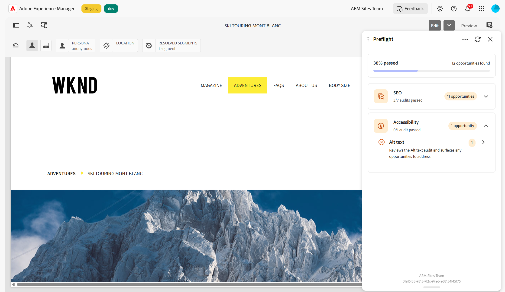

# Comprovação - Auditorias de acessibilidade

{align="center"}

A auditoria **Acessibilidade** na Comprovação avalia a página em relação às Diretrizes de Acessibilidade de Conteúdo da Web (WCAG) para ajudar a garantir que a página possa ser usada por todos, incluindo pessoas com deficiência. Quando você executa uma auditoria de Comprovação, ela avalia a página em relação a esses padrões de acessibilidade e agrupa os problemas encontrados em oportunidades que você pode revisar e resolver antes de publicar. Para obter mais informações sobre as verificações de acessibilidade e as diretrizes por elas abordadas, consulte [Problemas de acessibilidade](/help/documentation/opportunities/accessibility-issues.md).

No painel de resultados, expanda a categoria **Acessibilidade** para ver se a auditoria foi aprovada e o número de oportunidades encontradas. Selecione a auditoria para abrir sua página de detalhes e trabalhar pelas oportunidades. Cada oportunidade descreve o problema de acessibilidade e a regra WCAG e o nível de conformidade relacionados, juntamente com o elemento afetado na página. Quando o elemento tem texto legível, a comprovação mostra esse texto para que você possa reconhecer o elemento mais facilmente; caso contrário, mostra o seletor de CSS do elemento. Para saber como interpretar resultados e resolver oportunidades, consulte [Resultados de auditoria em Comprovação](../audit-results.md).
